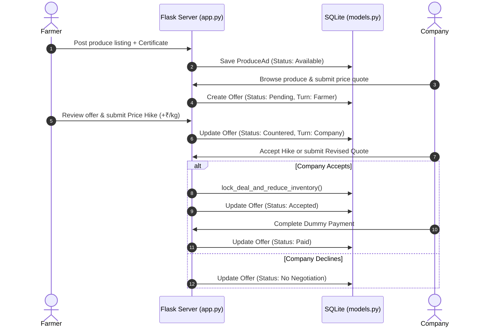

# 🌾 AgriConnect | Farmer-to-Company Produce Portal

[](https://www.python.org/downloads/)
[](https://flask.palletsprojects.com/)
[](https://flask-sqlalchemy.palletsprojects.com/)
[](https://sqlite.org/)
[](LICENSE)

**AgriConnect** is a modern B2B agri-tech platform designed to eliminate exploitative middlemen by connecting farmers directly with bulk-buying food processing companies, retail aggregators, and institutional purchasers. 

Through verified quality certifications, live inventory tracking, an interactive multi-round price negotiation engine, and automated deal locking, AgriConnect guarantees fair compensation for farmers and transparent, reliable procurement for businesses.

---

## 📌 Table of Contents
1. [Core Features](#-core-features)
   - [Farmer Portal](#1-farmer-portal)
   - [Company (Buyer) Portal](#2-company-buyer-portal)
   - [Interactive Negotiation Engine](#3-interactive-negotiation-engine)
   - [Inventory & Concurrency Management](#4-inventory--concurrency-management)
   - [Quality Certification System](#5-quality-certification-system)
   - [Security & Authentication](#6-security--authentication)
   - [Payment Gateway Simulation](#7-payment-gateway-simulation)
2. [Workflow & Architecture](#-workflow--architecture)
3. [Database Schema & Models](#-database-schema--models)
4. [Project Structure](#-project-structure)
5. [Installation & Setup](#-installation--setup)
6. [Inspecting the Database](#-inspecting-the-database)
7. [Roadmap](#-future-roadmap)
8. [License](#-license)

---

## 🚀 Core Features

### 1. Farmer Portal
* **Dedicated Authentication:** Secure registration and login requiring farmer name, email, land holding size, land location, and Aadhaar identification.
* **Produce Listing Management:**
  * Post crop ads with harvest date, available bulk quantity (in kg), asking price per kg, and minimum buying threshold.
  * Upload government or lab quality verification certificates (PDF, PNG, JPG).
* **Live Offer Inbox:** Real-time visibility into all incoming procurement requests from registered corporate buyers.
* **Negotiation Controls:**
  * **Accept Offer:** Instantly lock in deals at the buyer's quoted price.
  * **Hike Price (Counter-Offer):** Propose an upward price revision with a custom hike amount (e.g., `+₹2.50/kg`).
  * **No Negotiation (Decline):** Gracefully terminate negotiations if pricing is unsatisfactory.

---

### 2. Company (Buyer) Portal
* **Corporate Onboarding:** Business authentication requiring registered company name, corporate email, business type (e.g., Food Processing, Wholesaler, Exporter), and GSTIN.
* **Marketplace Discovery:**
  * Explore active crop listings with up-to-date available quantities and farmer location details.
  * Download and inspect uploaded crop quality certificates before offering quotes.
  * Visual indicators for produce availability status (`Available` vs `Sold Out`).
* **Intelligent Offer Placement:**
  * Custom quantity and per-kg quote submission.
  * Client-side and server-side validation enforcing minimum order quantity rules and stock limit ceilings.
* **Active Deal Tracking:**
  * View pending, countered, accepted, and paid bids.
  * Respond to farmer price hikes by revising quotes, accepting higher rates, or declining.

---

### 3. Interactive Negotiation Engine
The core business logic runs on an alternating **Turn-Based State Machine**:

* **Turn Management:** Strictly alternates between `farmer` and `company` to prevent race conditions and duplicate actions:
  * When a Company creates an offer $\rightarrow$ `turn = 'farmer'`
  * When a Farmer hikes price $\rightarrow$ `turn = 'company'`
  * When a Company counters with revised quote $\rightarrow$ `turn = 'farmer'`
* **Status Lifecycle:**
  * `Pending`: New offer awaiting farmer review.
  * `Countered`: Counter-quote proposed and awaiting the other party's response.
  * `Accepted`: Agreement reached; inventory locked for procurement.
  * `No Negotiation`: Negotiation closed without a transaction.
  * `Paid`: Full payment simulated and deal successfully finalized.

---

### 4. Inventory & Concurrency Management
* **Atomic Quantity Deductions:** When an offer is accepted, the requested quantity is deducted immediately from the produce ad's available stock.
* **Auto-Depletion & Status Updates:**
  * If quantity reaches `0 kg`, the ad transitions automatically to `Sold Out`, disabling further buyer bids.
  * If remaining stock drops below the previous `min_buying_quantity`, the threshold automatically scales down to the remaining balance.
* **Over-allocation Prevention:** Prevents deals from exceeding real-time on-hand inventory.

---

### 5. Quality Certification System
* **Whitelisted Extensions:** Restricts uploads strictly to `.pdf`, `.png`, `.jpg`, and `.jpeg`.
* **Path Traversal Protection:** Filenames are sanitized using `werkzeug.utils.secure_filename`.
* **Unique Collision Prevention:** Files are prefixed with user ID and UTC timestamps:
  ```
  farmer_{id}_{timestamp}_{sanitized_filename}
  ```
* **Storage Isolation:** Persisted under `static/uploads/certificates/` with zero direct script execution vulnerability.

---

### 6. Security & Authentication
* **Salted Password Hashing:** User passwords are never stored in plaintext; cryptographically hashed using PBKDF2/scrypt via Werkzeug.
* **Role-Based Access Control (RBAC):** Custom Python decorator `@login_required(role)` protects private routes:
  * Farmers cannot access company dashboards or actions.
  * Companies cannot access farmer management routes.
* **Signed Session Cookies:** Tamper-proof client sessions signed with Flask's secret key.

---

### 7. Payment Gateway Simulation
* **Mock Checkout Screen:** Clean, interactive UI summarizing crop type, farmer details, unit quote, quantity, and total billing amount.
* **Transactional State Transition:** Successfully completing payment marks the offer status as `Paid`.

---

## 🔄 Workflow & Architecture



---

## 🗄 Database Schema & Models

The relational database is powered by SQLite and managed via **Flask-SQLAlchemy**:

| Model | Table | Key Attributes | Relationships |
| :--- | :--- | :--- | :--- |
| **`Farmer`** | `farmers` | `id`, `name`, `email`, `password_hash`, `land_size`, `land_place`, `aadhaar_number` | One-to-Many with `ProduceAd` |
| **`Company`** | `companies` | `id`, `company_name`, `email`, `password_hash`, `business_type`, `gst_number` | One-to-Many with `Offer` |
| **`ProduceAd`** | `produce_ads` | `id`, `farmer_id`, `crop_name`, `certificate_filename`, `harvest_date`, `total_quantity`, `price_per_kg`, `min_buying_quantity`, `status` | Belongs to `Farmer`, One-to-Many with `Offer` |
| **`Offer`** | `offers` | `id`, `ad_id`, `company_id`, `requested_quantity`, `quote_price`, `last_hike_amount`, `turn`, `status` | Belongs to `ProduceAd` and `Company` |

---

## 📁 Project Structure

```
Agriconnect/
├── app.py                      # Main application server, routes & business logic
├── models.py                   # SQLAlchemy database schemas & ORM models
├── view_db.py                  # CLI utility to inspect all database records
├── requirements.txt            # Python dependencies
├── .gitignore                  # Git exclusions (database, cache, uploads)
├── README.md                   # Comprehensive project documentation
├── static/
│   ├── css/
│   │   └── style.css           # Custom stylesheets & UI styling
│   └── uploads/
│       └── certificates/       # Farmer quality check certificate storage
│           └── .gitkeep
└── templates/
    ├── base.html               # Base Jinja2 layout with navigation & flash alerts
    ├── index.html              # Landing homepage
    ├── farmer_auth.html        # Farmer sign-in & registration portal
    ├── farmer_dashboard.html   # Farmer ad posting & negotiation inbox
    ├── company_auth.html       # Corporate sign-in & registration portal
    ├── company_dashboard.html  # Market produce browsing & negotiation interface
    └── payment_gateway.html    # Demo payment simulation portal
```

---

## ⚙️ Installation & Setup

Follow these steps to run AgriConnect locally:

### 1. Prerequisites
* **Python 3.11+** installed on your system.
* **Git** installed on your system.

### 2. Clone the Repository
```bash
git clone https://github.com/samarth200808/Agriconnect.git
cd Agriconnect
```

### 3. Create a Virtual Environment
```bash
# Windows
python -m venv venv
venv\Scripts\activate

# macOS / Linux
python3 -m venv venv
source venv/bin/activate
```

### 4. Install Dependencies
```bash
pip install -r requirements.txt
```

### 5. Launch the Server
```bash
python app.py
```
*The database tables (`agriconnect.db`) will be created automatically on startup.*

### 6. Access the Application
Open your web browser and navigate to:
```
http://127.0.0.1:5000
```

---

## 🔍 Inspecting the Database

To inspect active database records directly from your terminal, run the included `view_db.py` script:

```bash
python view_db.py
```

**Output Example:**
```
============================================================
FARMERS
============================================================
ID: 1 | Name: Ramesh Kumar | Email: ramesh@agri.com | Land: 5 Acres (Punjab) | Aadhaar: 123456789121

============================================================
COMPANIES
============================================================
ID: 1 | Company: ITC Foods | Email: procurement@itc.com | Business Type: Food Processing | GST: 07AAAAA0000A1Z5

============================================================
PRODUCE ADS
============================================================
ID: 1 | Farmer ID: 1 | Crop: Wheat | Qty: 1000.0 kg | Price/kg: ₹24.0 | Status: Available

============================================================
OFFERS & NEGOTIATIONS
============================================================
ID: 1 | Ad ID: 1 | Company ID: 1 | Requested: 500.0 kg | Quote: ₹23.5/kg | Status: Pending | Turn: farmer
============================================================
```

---

## 🔮 Future Roadmap

- [ ] **Live Payment Gateway:** Integration with Razorpay / Stripe for real UPI, NetBanking, and Card payments.
- [ ] **SMS & WhatsApp Alerts:** Instant notification dispatch (via Twilio/Gupshup) to farmers when offers or hikes arrive.
- [ ] **Logistics & Escrow:** Integrated freight transport booking and escrow fund releases upon produce delivery.
- [ ] **Multilingual Support:** Localization in Hindi, Punjabi, Marathi, Telugu, Tamil, and other regional languages.
- [ ] **AI Price Advisory:** Price recommendations based on APMC Mandi trends and historical market data.

---

## 📄 License
This project is open-source and available under the [MIT License](LICENSE).
